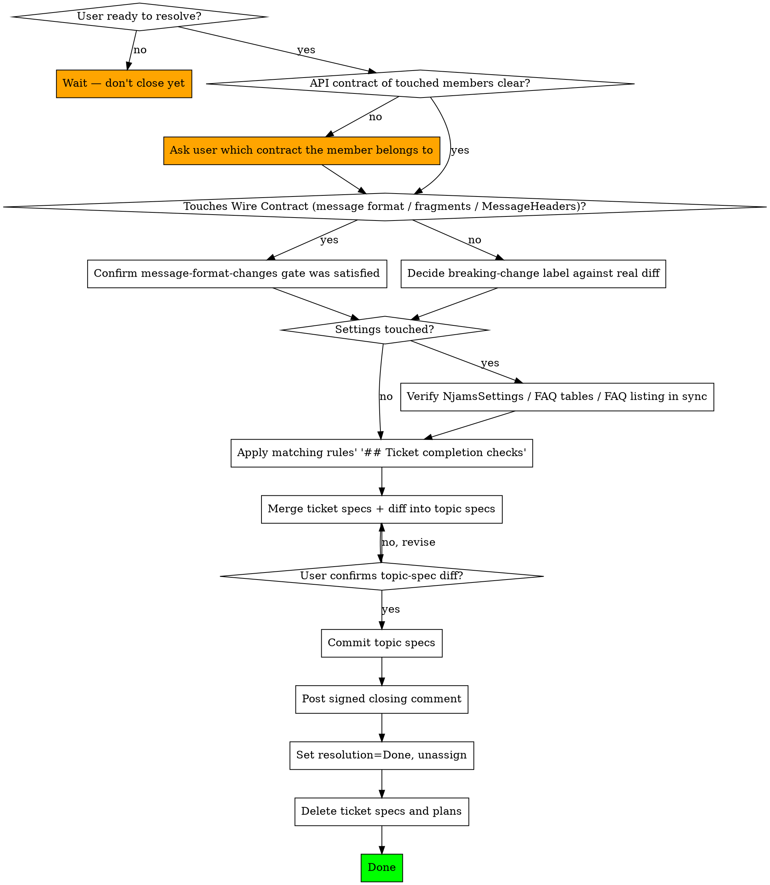

# Ticket Wrap-Up for nJAMS SDK

## Overview

Closing a ticket is the mirror image of `njams-ticket-start`, and it's just as easy to do inconsistently if it isn't checked against a list: the breaking-change label needs an actual decision now that the real diff exists — kickoff deliberately leaves it unset in most cases, so this is usually the first point where the answer is even knowable, not a recheck of an earlier guess. The ticket also needs to actually move to a resolved state. Its ticket specs and plans under `docs/superpowers/` live only as long as the ticket: what is worth keeping is merged into the permanent topic specs under `docs/specs/` first, and then they go. Skipping the merge loses decisions; skipping the deletion leaves outdated specs that later work scans and trusts. Getting this wrong either leaves stale "In Progress" tickets on the board, or clutters Jira with premature closing comments before the user actually wants to resolve anything.

## Hard Rules

**Only run this when the user is actually resolving the ticket** — not just because the code looks finished to you. Verification passing is necessary but not sufficient; wait for the user's go-ahead to close.

**Decide the `breaking-change` label against the actual diff — but only for Client Contract and SPI Contract changes.** In most cases nothing was set at kickoff — treat this as the real decision, not a recheck. Add it if the change touches a public/protected signature, return type, parameter type, or removes/alters observable behavior. Remove it if the change turned out to be purely additive or fully internal (this includes undoing a kickoff-time label, on the rare occasion the ticket description turned out to be misleading). New methods, classes, and overloads are never breaking on their own.

**If the change touches the Wire Contract — the njams-messageformat types, `communication/fragments/`, or `MessageHeaders`/properties — don't decide a `breaking-change` label for it at all.** That contract is governed by `message-format-changes.md`'s human-confirmation + `SER`-ticket gate instead. Before closing, confirm that gate was actually satisfied for this change (a human explicitly confirmed it, and a `SER` ticket exists if nJAMS Server needs a corresponding update) — don't resolve the ticket if it wasn't.

**If the API contract a touched member belongs to is itself unclear, ask — don't guess.** Java `public`/`protected` visibility is not the same thing as public API in this codebase, and public API itself isn't one contract (see `public-api-design.md`): a member can be Internal despite the modifier (e.g. `communication/` plumbing that isn't part of the SPI or Wire Contract), the Client Contract, the SPI Contract, or the Wire Contract — and none of these carry the same breaking-change weight (the Wire Contract doesn't use the label at all). If a touched member doesn't clearly fall into one of these — it's not covered by an existing documented exclusion, and you can't confidently say which contract it belongs to — stop and ask the user which it is rather than picking a label on a guess. Getting this wrong is exactly the failure mode this label exists to prevent.

**Post a closing comment before or as part of resolving**, and keep it brief: state that the issue is resolved and optionally the root cause. Implementation detail belongs in commit messages, not the Jira comment. Every comment posted to Jira must end with:
```
---
_Generated by Claude Code_
```
Write it in Markdown with `contentFormat=markdown` — wiki markup (`h2.`, `_..._`) renders broken.

**Set resolution to `Done` and clear the assignee** as part of the same transition.

**Consolidate into the topic specs before resolving — with the user's confirmation.** Topic specs (`docs/specs/<topic>.md`) are the permanent design record; their content rules are in `specs-and-plans-lifecycle.md`. Two sources feed them:
- every ticket spec of this ticket (`docs/superpowers/specs/*-sdk-<number>-*`) — merge the decisions, invariants and non-obvious reasoning that still hold into the affected topic specs, or create a new topic spec;
- the ticket's diff itself, also when there is no ticket spec — if it changes what a topic spec states, update that topic spec.

Present the resulting topic-spec diff, and ask in the same message for confirmation of the content and for permission to commit it; commit it before posting the closing comment. If you conclude nothing needs to change, say so with the reason and let the user confirm that too — never skip this step silently.

**Delete the ticket's specs and plans only after the ticket is actually resolved, not before.** Remove `docs/superpowers/plans/*-sdk-<number>-*.md` and `docs/superpowers/specs/*-sdk-<number>-*` together with any asset folder `docs/superpowers/specs/sdk-<number>-*/` once the resolution transition below has actually happened, since "work has shipped" isn't the same as "ticket resolved."

**If the ticket touched any settings**, confirm `NjamsSettings` and the settings tables and settings listing in `wiki/FAQ.md` are all in sync before closing — see `njams-settings-sync`. Don't resolve a settings-touching ticket with docs out of sync.

**Apply the project rules' completion checks.** Rules under `.claude/rules/` may contribute their own checks in a section titled `## Ticket completion checks`. Before resolving, apply every such section whose rule's path scope (the `paths:` frontmatter; a rule without one applies always) matches files in the ticket's diff. A check that says "propose" means propose to the user and wait for the answer; don't resolve the ticket while a proposed check is still unanswered. This keeps project-specific steps in the rules that own them instead of in this skill.

## Workflow



## Steps in Detail

**1. Confirm this is really the close.**
If the user says "looks good" but hasn't said to resolve the ticket, that's not a trigger — keep working or wait.

**2. Place each touched member in its API contract, then decide accordingly.**
This is normally the first real decision on the breaking-change label, not a recheck — kickoff only sets it when the ticket description already made it obvious, which is the exception rather than the rule. For each touched `public`/`protected` member, first confirm which contract it's in (see `public-api-design.md`):
- Internal — not public API at all despite the Java modifier (e.g. `communication/` plumbing that isn't SPI or Wire Contract, or code `public` only for cross-package access)
- Client Contract — the client-facing contract
- SPI Contract — an SPI extension point
- Wire Contract — the njams-messageformat types, `communication/fragments/`, or `MessageHeaders`/properties

If that's genuinely unclear for a given member — it's not covered by a documented exclusion and you can't tell which contract applies — ask the user before deciding anything, rather than picking on a guess.

If the member is in the **Wire Contract**, don't set a `breaking-change` label for it — confirm the `message-format-changes.md` gate was satisfied instead (human confirmation, plus a `SER` ticket if nJAMS Server needs a corresponding change), and hold off resolving if it wasn't.

Otherwise (Internal, Client Contract, or SPI Contract), diff the actual changes against the criteria (signature, return type, or parameter type change; removal; observable behavior change) and set or remove the `breaking-change` label accordingly.

**3. Check settings sync if relevant.**
If any `PROPERTY_*` key changed, was added, or was deprecated, don't resolve until `njams-settings-sync` has been applied.

**4. Apply the rules' completion checks.**
List the files in the ticket's diff, then grep `.claude/rules/*.md` for the heading `## Ticket completion checks`. For each rule that has it and whose path scope matches those files, carry out its checks (e.g. proposing a test suite run) and resolve any open question with the user before continuing. Skip rules whose scope doesn't match the diff.

**5. Consolidate into the topic specs.**
Read the ticket's specs under `docs/superpowers/specs/` and its diff, and find the affected topic specs under `docs/specs/` (grep for the touched classes and the area). Rewrite the affected parts so each topic spec reads as the current state, following `specs-and-plans-lifecycle.md`; add the ticket key to its `Tickets:` line. Create a new topic spec when the ticket introduced an area no topic spec covers yet. Diagrams the topic spec uses go into `docs/specs/<topic>/`. If a ticket spec of an already resolved ticket covers the same topic and is now fully absorbed, propose deleting it in step 7 too. Show the user the diff, revise until they confirm, and commit it once they agree. If nothing needs to change, state why and get that confirmed instead.

**6. Comment, then resolve.**
Post the closing comment first (or as part of the same transition, depending on the tool), then set resolution to `Done` and clear the assignee.

**7. Only now, delete the ticket's specs and plans.**
With the ticket actually resolved, delete `docs/superpowers/plans/*-sdk-<ticket-number>-*.md`, `docs/superpowers/specs/*-sdk-<ticket-number>-*` and any asset folder `docs/superpowers/specs/sdk-<ticket-number>-*/`. Delete in the same step any absorbed leftover spec the user agreed to in step 5. Commit the deletion once the user agrees. Don't delete anything earlier in the sequence — "code shipped" and "ticket resolved" are different things.

## Common Mistakes

| Mistake | Correct Approach |
|---------|-----------------|
| Posting a closing comment because the code feels done | Only post it when the user is actually resolving the ticket |
| Assuming a label (or its absence) from kickoff is already correct | Decide it fresh against the real diff — kickoff only sets it when the ticket description already made it obvious |
| Guessing whether a touched member is really public API when it's ambiguous | Ask the user which contract it belongs to (Internal / Client Contract / SPI Contract / Wire Contract) instead of picking a label on a guess |
| Setting a breaking-change label for a message-format/fragments/MessageHeaders change | That's the Wire Contract — confirm the message-format-changes.md gate instead, don't use the label |
| Resolving without clearing the assignee | Both happen together: resolution=Done and unassigned |
| Leaving the ticket's specs or plans in docs/superpowers/ after the ticket is resolved | Delete them — only topic specs under docs/specs/ are permanent |
| Deleting a ticket spec without merging it into the topic specs first | Consolidate and get the topic-spec diff confirmed before resolving |
| Skipping the topic specs because the ticket had no ticket spec | Check the diff against the topic specs anyway — it may change what one states |
| Appending an "Update (SDK-123)" section to a topic spec | Rewrite the affected parts so the spec describes the current state |
| Deleting specs or plans before the ticket is actually resolved (e.g. right after code ships) | Wait until resolution=Done is actually set — merged code isn't the same as a resolved ticket |
| Closing a ticket that changed a setting without checking the FAQ/properties file | Run njams-settings-sync first |
| Resolving without checking the project rules' `## Ticket completion checks` | Grep `.claude/rules/*.md` for the heading and apply the ones whose scope matches the diff |
| Writing a long technical closing comment | Keep it to root cause + resolution; details belong in commits |
