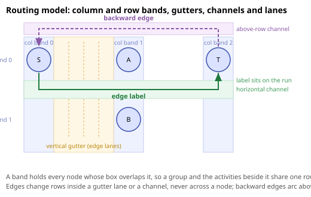

# Polyline Process-Diagram Routing

## Scope

`PolylineProcessDiagramFactory` (`model/svg/`) is an opt-in subclass of `NjamsProcessDiagramFactory` that draws
transitions as orthogonal `<polyline>` routes instead of straight centre-to-centre `<line>`s, so that no arrow
crosses an activity icon, an activity's label, or a group box. A client selects it with
`njams.model().setDiagramFactory(new PolylineProcessDiagramFactory(njams))`; nothing else is configured.

1. **Only edges are routed.** Activity and group placement stays entirely the layouter's business
   (`CommonBfsModelLayouter` by default); activity, group and document drawing are inherited unchanged. There is
   no companion layouter: the default spacing proved sufficient for the corridors.
2. **The default factory is unchanged.** The base class gained only additive `protected` hooks
   (`drawTransition`, `getAdditionalBounds`); its own output must not change observably because of this factory.
3. **Not on the runtime path.** Routing runs once per process model, when `ProcessModel` builds its SVG for the
   project message. Clarity is preferred over micro-optimisation, within reason — a diagram can hold many
   activities.
4. **The factory instance is shared.** Routing state exists only for the duration of one diagram build and never
   carries over to the next.

## SVG contract with nJAMS Server

nJAMS Server parses the SVG to overlay runtime state (e.g. colouring executed transitions) and for interaction.
A routed transition is a `<polyline>` carrying the same identifying attributes as the default `<line>`
(`modelId`, `markerId`, `name`, `marker-end`), plus `points`, and is not filled (a filled polyline would paint the
area its corners enclose). The arrow marker is the base factory's, aligned to the last segment. Labels are the base
factory's `<text>` elements; a truncated label carries the full text as a tooltip attribute on the polyline.
`<polyline>` was confirmed to render on nJAMS Server; do not switch to `<path>` or change the element/attribute
shape without checking it against nJAMS Server — the SVG travels in the project message.

## Routing model

The whole model is routed before the inherited drawing runs; a transition without a route falls back to the
inherited straight line.

Routing runs **per container**: the root level, and each group's children separately. A transition whose
endpoints have different parents (cross-container) is not routed and keeps the straight line — such transitions
do not occur in practice, and routing them would need an obstacle model spanning two containers. An edge whose
source or target *is* a group is routed like any other edge.

1. **Node boxes.** A plain activity is its icon box plus the label band below it, where its name is written; a group
   is its box alone (its name is drawn inside its header). The connector centre is the box centre, which for a
   group matches the base factory's straight-line anchor.
2. **Obstacles.** Every sibling in the container, with a clearance margin, except the edge's own two endpoints. A
   route is blocked when a segment of it intersects an obstacle. This is the only test for "something is in the
   way".
3. **Bands.** Rows and columns are **overlap bands**: every node whose box overlaps another's on that axis shares
   its band, so a group and the plain activities beside it form one row. Bands cover every sibling, including ones
   without transitions. They are only the grouping key for corridors and lanes and decide the column/row
   relationship of an edge; they never decide whether a route is clear.
4. **Corridors.** A *gutter* is a vertical corridor between two column bands, a *channel* a horizontal corridor
   between two row bands, kept clear of the activity labels above it. Past the first/last band the default spacing
   provides the corridor.
5. **Inside a group**, channels stay between the group's header and its bottom border.

## Edge shapes

Each edge gets one of four shapes, decided by the bands of its two nodes and whether the direct segment is clear:

| Shape | When | Route |
|---|---|---|
| Straight | direct segment clear, and same column, or same row with adjacent columns | direct segment |
| Backward | target column left of the source column | leaves the source's top, runs back in the channel above the higher of the two rows, enters the target's top |
| Bypass | otherwise, same row | leaves to the right, drops into the channel below the row, crosses, rises in the gutter before the target, enters it from the side below its centre |
| Elbow | otherwise, different rows | see below |

An elbow takes one of two forms:

1. **Side-entering** (horizontal–vertical–horizontal), the vertical run in a gutter. A fan-out or plain elbow
   turns in the gutter right of the source column; a pure fan-in turns in the gutter left of the target column, so
   a long join does not cut across the target's row. If a fan-in's run along the source row would hit a sibling,
   it detours through the source row's channel first. Two nodes in the same column always take this form.
2. **Vertical approach** (vertical–horizontal–vertical), when the columns differ and the vertical distance exceeds
   the horizontal one. It leaves the source's bottom or top, crosses in the channel between the two rows, and
   enters the target's top or the lower edge of its label band.

A straight edge with a vertically dominant approach attaches at top and bottom. Self-transitions are not
supported, as in the default layouter.

## Candidate escalation

Clearance is checked on the **drawn** path — after lanes and stagger, with the actual attachment points — because
those displace a run far enough to land it in the next band. Each blocked edge, and only that edge, moves to its
next candidate: a straight edge takes its routed shape, a routed edge moves its channel one band further out (below
for forward edges, above for backward ones), a side-entering elbow first takes the row detour. Lanes are then
reassigned and the check repeated. Steps and rounds are bounded; an edge still blocked afterwards is drawn as is
and logged at debug level, never overlapping silently.

## Fans, lanes and stagger

1. **One shape per fan.** All branches of a fan-out (shared source) or fan-in (shared target) take the
   side-entering form as soon as one of them does; only a fan that approaches vertically throughout keeps the
   vertical form. Branch non-crossing follows from lane nesting, which only holds while a fan shares one shape
   family; edge-versus-edge intersection is deliberately not part of the obstacle test.
2. **Lanes.** Edges sharing a corridor get distinct, evenly spaced lanes. Side-entering elbows nest so branches
   never cross: fan-out with the longest vertical run outermost, fan-in with the longest run innermost. The gutters
   a bypass uses are claimed, so elbows there take the next lane.
3. **Stagger.** Branches leaving or entering one node are offset so that no two share a collinear run: a
   server-coloured executed transition must never be hidden behind an unexecuted sibling.
4. Nothing an edge derived in one round (lanes, stagger, attachment sides) carries over into the next round.

## Attachments

A route starts and ends at an attachment point; the arrow tip lands exactly on it.

1. Plain activity, from the left, right or top: just outside the icon.
2. Plain activity, from below: the lower edge of the label band — an arrow from below points at the label and never
   runs through it to the icon. The strip below the label band, where nJAMS Server may overlay information, is
   accepted as free.
3. Group: on the box edge, on the side the route arrives from, at the route's own position — so the branches of a
   fan meet a group at separate points, not all at its centre.

## Labels

1. Wrapping, truncation, tooltip and the label suppression for `njams.sdk.server.compatibility=6.1` behave as in
   the base factory.
2. A label sits on a clear axis-aligned run of its own route, never at a corner, and never on a node, another
   label or a sibling's run.
3. Labels of a fan's branches separate by row: fan-out labels end just before the target, fan-in labels start just
   after the source.
4. A label never extends into the space below a horizontal straight edge, because staggered sibling runs use it.

## Canvas bounds

`getAdditionalBounds` reports every route and its label, so the base factory grows the canvas around them with
the same margin as around activities. Channels above the first row, bottom attachments and corridors past the last
band would otherwise be clipped.

## Invariants

1. No routed edge crosses an activity box, a group box or an activity label band, whatever the vertical offset
   between its endpoints. This is decided by segment-versus-box intersection on the drawn geometry — never by
   coordinate equality and never on the nominal corridor.
2. Bands are overlap bands; exact-coordinate rows/columns or centre-based clustering are not reintroduced (they
   would split a group from the activities beside it).
3. All branches of a fan share one shape family; branches never cross each other.
4. Edges sharing a corridor never coincide; edges leaving or entering one node never share a collinear run.
5. Inside a group, routes stay between the header and the bottom border.
6. The routing stays internal to the factory: its public constructor and the overridden `protected` members do not
   change, and the default factory's output does not change.
7. The SVG element/attribute shape described above stays as is.

## Decisions not to reopen

1. Backward edges arc **above** their row, because below is where bypass channels and activity labels are.
2. When one branch of a fan is blocked, only that branch escalates, not its clear siblings. Fan shape alignment is
   a separate step.
3. Production and test each keep their own intersection test, so the tests verify the router independently.
4. The backward-edge test places coordinates explicitly: `CommonBfsModelLayouter` does not handle feedback loops
   and does not reliably place a loop head left of the node looping back to it.

## Tests

`PolylineProcessDiagramFactoryTest` asserts the invariants on the parsed SVG. Tests pinning exact geometry may be
rewritten to assert the invariant instead; the invariant assertions themselves are the contract.
`PolylineDiagramSampleRenderingTest` renders sample diagrams through both factories for visual review.
